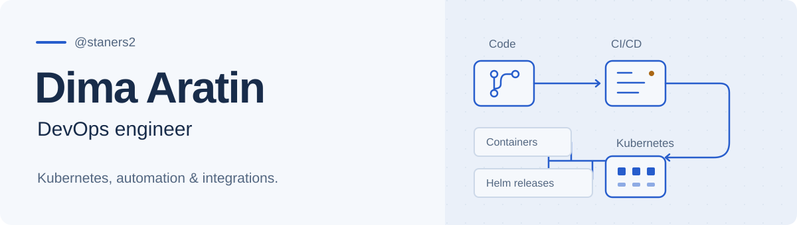
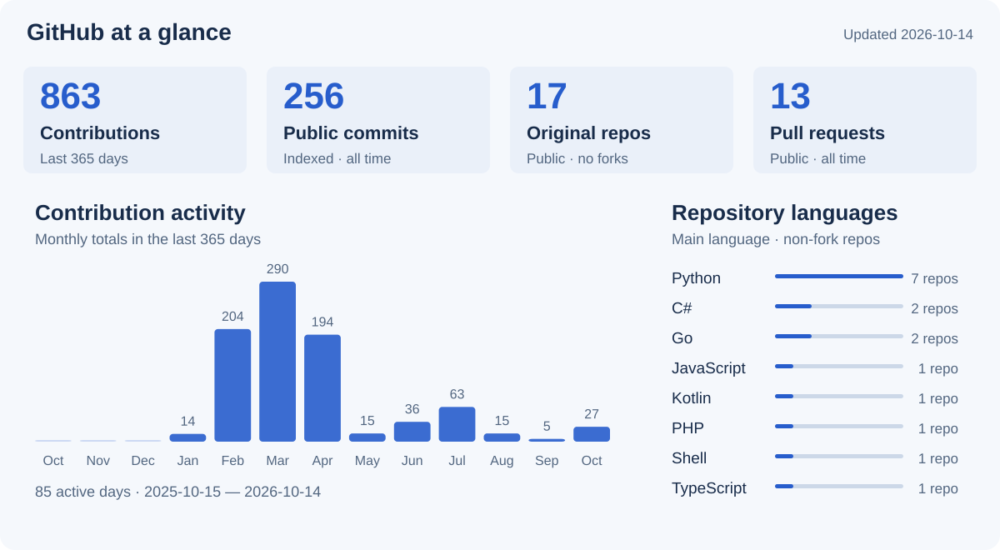

<picture>
  <source media="(prefers-color-scheme: dark) and (max-width: 600px)" srcset="assets/header-mobile-dark.svg">
  <source media="(prefers-color-scheme: light) and (max-width: 600px)" srcset="assets/header-mobile-light.svg">
  <source media="(prefers-color-scheme: dark)" srcset="assets/header-dark.svg">
  <source media="(prefers-color-scheme: light)" srcset="assets/header-light.svg">
  
</picture>

 

I’m a **DevOps engineer** working with Kubernetes, CI/CD and Python.
I build deployment workflows, automation tools and practical integrations, with an interest in self-hosted applications.

[Telegram](https://t.me/AratinDima) · [LinkedIn](https://www.linkedin.com/in/dimaaratin/) · [All repositories](https://github.com/staners2?tab=repositories)

### GitHub activity

<picture>
  <source media="(prefers-color-scheme: dark) and (max-width: 600px)" srcset="assets/stats-mobile-dark.svg">
  <source media="(prefers-color-scheme: light) and (max-width: 600px)" srcset="assets/stats-mobile-light.svg">
  <source media="(prefers-color-scheme: dark)" srcset="assets/stats-dark.svg">
  <source media="(prefers-color-scheme: light)" srcset="assets/stats-light.svg">
  
</picture>

Contributions follow the public profile, including anonymized private activity where shown. Commit totals cover indexed public default branches.

### What I work with

| Area | Technologies |
| --- | --- |
| Infrastructure | Kubernetes, Helm, Docker, Talos Linux |
| Delivery | GitLab CI/CD, GitHub Actions |
| Code & data | Python, Go, TypeScript, JavaScript, PostgreSQL |

### [Boosty for Samsung TV](https://github.com/staners2/boosty-samsung-tv)

An unofficial, self-hosted reader and video player for Samsung Tizen TVs and PC browsers. Read full posts, view images and watch subscription videos using a TV remote or a mouse.

Desktop browser preview with demo content. Native playback requires verification on the target TV.

- **Deployment:** Docker Compose and a Helm chart for Kubernetes, with persistent storage and configurable routing.
- **Integration:** phone pairing and a server-side encrypted session vault.
- **Media:** FFmpeg frame previews, caching and video chapter navigation.
- **Delivery:** automated tests, GitHub Actions and documented installation paths.

`JavaScript` `Node.js` `FFmpeg` `Tizen` `Docker` `Helm` `Kubernetes`

[Source & setup](https://github.com/staners2/boosty-samsung-tv) · [Screenshots](https://github.com/staners2/boosty-samsung-tv#screenshots)

---

Have a question about infrastructure, automation or a project here? [Let’s talk on Telegram.](https://t.me/AratinDima)
